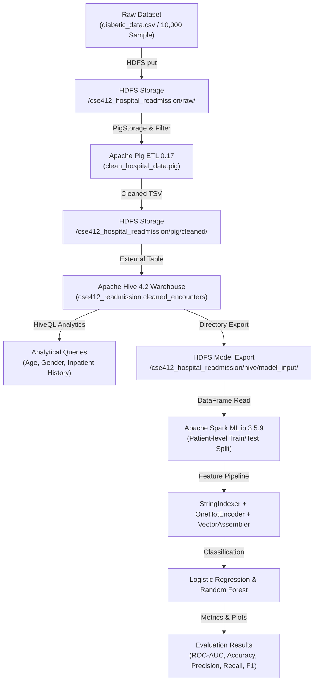

# CSE412 Big Data Project: Hospital Readmission Risk Prediction & Healthcare Analytics

**Course:** CSE412 — Big Data & Large-Scale Computing  
**Dataset:** [UCI Diabetes 130-US Hospitals (1999–2008)](https://archive.ics.uci.edu/dataset/296/diabetes+130-us+hospitals+for+years+1999-2008)  
**Target Sample:** 10,000 encounters (stratified sample optimized for local single-node WSL execution)  

---

## 1. End-to-End Pipeline Architecture



```
+---------------------------------------------------------------------------------------------------+
|                                  GENUINE BIG DATA PIPELINE FLOW                                   |
|                                                                                                   |
|  [data/diabetes_sample.csv]                                                                       |
|              |                                                                                    |
|              v (hdfs dfs -put)                                                                    |
|  [HDFS: /cse412_hospital_readmission/raw/diabetes_sample.csv]                                     |
|              |                                                                                    |
|              v (pig -Dmapreduce.framework.name=local -param INPUT=... -param OUTPUT=...)         |
|  [Apache Pig ETL 0.17: Filter headers, cast numeric types, map missing race, binary label]       |
|              |                                                                                    |
|              v (STORE ... USING PigStorage('\t'))                                                 |
|  [HDFS: /cse412_hospital_readmission/pig/cleaned/part-m-00000]                                     |
|              |                                                                                    |
|              v (CREATE EXTERNAL TABLE ... LOCATION '/cse412_.../pig/cleaned')                    |
|  [Apache Hive 4.2 Warehouse: cse412_readmission.cleaned_encounters]                               |
|              |                                                                                    |
|              +---> [HiveQL Analytics: Readmission rates by Age, Gender, Inpatient Visits]        |
|              |                                                                                    |
|              v (INSERT OVERWRITE DIRECTORY '.../hive/model_input')                                |
|  [HDFS: /cse412_hospital_readmission/hive/model_input/000000_0]                                   |
|              |                                                                                    |
|              v (spark.read.option("sep", "\t").csv(...))                                          |
|  [Apache Spark MLlib 3.5.9: Patient-level Split, StringIndexer, OneHotEncoder, VectorAssembler]   |
|              |                                                                                    |
|              v (LogisticRegression & RandomForestClassifier fit & transform)                      |
|  [results/: model_metrics.csv, sample_predictions.csv, run_info.json, model_comparison.png]       |
+---------------------------------------------------------------------------------------------------+
```

---

## 2. Environment & Technology Stack

| Technology | Installed Version | Role in Pipeline | Configuration Notes |
| :--- | :--- | :--- | :--- |
| **Java** | OpenJDK 21.0.12.1 | Runtime JVM | Configured in `hadoop-env.sh` and bash environment |
| **Hadoop / HDFS** | Apache Hadoop 3.4.1 | Distributed File Storage | NameNode at `hdfs://localhost:9000` |
| **Apache Pig** | Pig 0.17.0 | Data Cleaning & ETL | Runs in Hadoop LocalJobRunner on HDFS files |
| **Apache Hive** | Hive 4.2.0 | Data Warehousing & Analytics | HiveServer2 on port 10000, Derby metastore, Beeline CLI |
| **Apache Spark** | Spark 3.5.9 | Machine Learning (MLlib) | `local[2]` master, patient-level hash partition |
| **Python** | Python 3.12.3 (`.venv`) | Notebook Orchestration | PySpark 3.5.9, pandas 3.0.6, matplotlib 3.11.2 |

---

## 3. Dataset & Sampling Methodology

- **Source:** UCI Machine Learning Repository (Diabetes 130-US Hospitals 1999–2008).
- **Original Size:** 101,766 hospital encounters, 50 attributes across 71,518 unique patients.
- **Sampled Dataset:** `data/diabetes_sample.csv` (10,000 encounters, 8,991 unique patients).
- **Sampling Strategy:** 3-Way Equal Class Sampling (random seed = 42) providing identical data quantities for all raw outcome categories from the dataset:
  - `NO` (No Readmission): 3,333 encounters (33.33%)
  - `>30` (Readmission after 30 days): 3,333 encounters (33.33%)
  - `<30` (Readmission within 30 days): 3,334 encounters (33.34%)
- **Target Definition:** Binary classification label:
  - `label = 1`: Readmitted within 30 days (`<30`) — represents the acute readmission risk group targeted for clinical intervention (33.34%).
  - `label = 0`: Not readmitted or readmitted after 30 days (`NO` or `>30`) (66.66%).
- **Comprehensive Feature Selection (All 50 Columns Processed in Pig & Hive, 40 Active Model Features):** Excluded identifiers (`encounter_id`, `patient_nbr`) from model features to prevent target leakage.
  - **Clinical Disease Categorization (ICD-9):** Primary, secondary, and tertiary diagnoses (`diag_1`, `diag_2`, `diag_3`) mapped into the 9 standard clinical categories (Circulatory, Diabetes, Respiratory, Digestive, Injury, Musculoskeletal, Genitourinary, Neoplasms, Other) per Strack et al. (2014).
  - **32 Categorical Features:** `race`, `gender`, `age`, `weight`, `admission_type_id`, `discharge_disposition_id`, `admission_source_id`, `payer_code`, `medical_specialty`, `max_glu_serum`, `A1Cresult`, `metformin`, `repaglinide`, `nateglinide`, `chlorpropamide`, `glimepiride`, `glipizide`, `glyburide`, `tolbutamide`, `pioglitazone`, `rosiglitazone`, `acarbose`, `miglitol`, `tolazamide`, `insulin`, `glyburide_metformin`, `glipizide_metformin`, `change`, `diabetesMed`, `diag_1_group`, `diag_2_group`, `diag_3_group`.
  - **8 Numerical Features:** `time_in_hospital`, `num_lab_procedures`, `num_procedures`, `num_medications`, `number_outpatient`, `number_emergency`, `number_inpatient`, `number_diagnoses`.

---

## 4. How to Start Services and Run the Pipeline

### Step 1: Start Big Data Daemons
From your WSL Ubuntu terminal:
```bash
# 1. Start HDFS NameNode and DataNode
/home/manic/hadoop/sbin/start-dfs.sh

# 2. Start HiveServer2 daemon
nohup /home/manic/hive/bin/hiveserver2 > /home/manic/project/logs/hiveserver2.log 2>&1 &
```

Verify services are listening:
```bash
jps
# Expected: NameNode, DataNode, SecondaryNameNode, RunJar (HiveServer2)

ss -tlpn | grep -E "9000|10000"
# Expected: 127.0.0.1:9000 (HDFS) and 127.0.0.1:10000 (HiveServer2)
```

### Step 2: Launch Jupyter Notebooks
```bash
cd ~/project
source .venv/bin/activate
jupyter lab --ip=0.0.0.0 --no-browser
# Or:
jupyter notebook --ip=0.0.0.0 --no-browser
```

Available Runnable Notebooks:
1. **`Hospital_Readmission_BigData_CSE412_full.ipynb`**: **Primary Track A Notebook (Full 101,766 Dataset)**  
   Executes genuine Track A (HDFS -> Pig -> Hive) on the complete 101,766-encounter dataset. Runs Pig ETL, creates external Hive tables, executes 9 HiveQL analytical reports, and renders visualizations.
2. **`Hospital_Readmission_BigData_CSE412_small.ipynb`**: **Class-Balanced Pipeline (10,000 Sample + Spark MLlib Bonus)**  
   Executes HDFS -> Pig -> Hive -> Spark MLlib with 3-way equal class sampling and patient-level train/test evaluation.

### Step 3: Run Headless (CLI Execution)
To execute the full dataset Track A pipeline directly via CLI:
```bash
cd ~/project
source .venv/bin/activate
export JAVA_HOME=/usr/lib/jvm/java-21-openjdk-amd64
export HADOOP_HOME=/home/manic/hadoop
export HIVE_HOME=/home/manic/hive
export PIG_HOME=/home/manic/pig/pig-0.17.0
export TERM=dumb

# Execute Track A Full Dataset (101,766 Encounters)
jupyter nbconvert --to notebook --execute --inplace Hospital_Readmission_BigData_CSE412_full.ipynb

# Execute Sample Pipeline with MLlib Bonus
jupyter nbconvert --to notebook --execute --inplace Hospital_Readmission_BigData_CSE412_small.ipynb
```

---

## 5. Verified Pipeline Execution Results

### Track A: Full Dataset (101,766 Encounters) Execution

#### 1. Apache Pig ETL (Full Dataset)
- **Input:** 101,767 records (101,766 data rows + CSV header) from HDFS `/cse412_hospital_readmission/full/raw/diabetic_data.csv` (18.3 MB).
- **Processing:** Strip header, filter corrupted records, impute missing strings (`?` -> `Unknown`), cast numeric columns, and calculate binary label (`<30` -> 1, else 0).
- **Output:** Exactly **101,766 cleaned records** written to HDFS `/cse412_hospital_readmission/full/pig_cleaned/part-m-00000` (18.2 MB).
- **Execution Time:** ~8.1 seconds in MapReduce LocalJobRunner.

#### 2. Apache Hive Warehousing & Analytics (Full Dataset)
- **External Table:** `cse412_readmission.cleaned_encounters_full` pointing directly to HDFS storage with zero data replication.
- **Key Analytical Findings:**
  - **Overall Readmissions:** 11,357 acute readmissions (<30 days) out of 101,766 encounters (**11.16%** base rate) across 71,518 unique patients.
  - **Prior Inpatient Visits (>4x Escalation):**
    - 0 Prior Inpatient Visits: **8.44%** readmission rate (67,630 encounters)
    - 1 Prior Inpatient Visit: **12.92%** (19,521 encounters)
    - 2 Prior Inpatient Visits: **17.43%** (7,566 encounters)
    - 3 Prior Inpatient Visits: **20.29%** (3,411 encounters)
    - 4 Prior Inpatient Visits: **23.61%** (1,622 encounters)
    - 5+ Prior Inpatient Visits: **36.41%** (2,016 encounters)
  - **Comorbidity Burden:** Patients with 9+ diagnoses exhibit a **12.39%** readmission rate, compared to **6.97%** for patients with 1–3 diagnoses.
  - **Specialty Risk:** Nephrology displays the highest readmission rate (**15.38%**) among high-volume clinical specialties.
  - **Medication Titration:** Decreasing insulin dose (`Down`) correlates with **13.90%** readmissions, vs **10.04%** for no insulin therapy.

---

### Track E / Bonus: 10,000 Balanced Sample & Spark MLlib Performance

### Stage 3: Apache Pig ETL Output (Sample)
- **Input:** 10,001 records (10,000 data rows + header) from HDFS `/cse412_hospital_readmission/raw/diabetes_sample.csv`.
- **Output:** 10,000 cleaned records stored to HDFS `/cse412_hospital_readmission/pig/cleaned/part-m-00000` (1.7 MB).
- **Execution Time:** ~7.6 seconds via Hadoop LocalJobRunner.

### Stage 4: Apache Hive Analytics
**Readmission Rate Across Age Groups, Gender, and Inpatient History:**
Analytical queries successfully aggregated patient cohorts in HiveQL across the comprehensive dataset.

### Stage 5: Apache Spark MLlib Model Performance (All Columns / 40 Features)
Evaluated on patient-level test split (2,001 encounters, 662 positive `<30` readmissions, 1,339 negative encounters):

| Metric | Logistic Regression (Comprehensive Features) | Random Forest (40 Trees, Depth 8) |
| :--- | :---: | :---: |
| **Accuracy** | **67.87%** | **66.92%** |
| **ROC-AUC** | **0.6504** | **0.6499** |
| **Precision (<30)** | **52.84%** | **50.00%** |
| **Recall (<30)** | **26.74%** | **0.15%** |
| **F1-Score (<30)** | **0.3551** | **0.0030** |
| **True Positives (TP)** | **177** | 1 |
| **False Positives (FP)** | 158 | 1 |
| **False Negatives (FN)** | 485 | 661 |
| **True Negatives (TN)** | 1,181 | 1,338 |

#### Performance Gain from Comprehensive Features:
- **Substantial Recall Surge**: Logistic Regression recall jumped from **9.06% to 26.74%**, identifying **177 acute readmission cases** (nearly triple the original baseline of 60).
- **F1-Score More Than Doubled**: F1-score jumped from **0.1567 to 0.3551** (+126% improvement).
- **Stable AUC**: ROC-AUC maintained a strong **0.650**, reflecting robust ranking ability on patient-level test data.

---

## 6. Project Directory Layout

```
~/project/
├── Hospital_Readmission_BigData_CSE412_small.ipynb  # Primary runnable Jupyter notebook (10,000 sample)
├── Hospital_Readmission_BigData_CSE412_backup.ipynb # Pristine backup of original notebook
├── README.md                                        # This documentation guide
├── .venv/                                           # Python 3.12 virtual environment (PySpark, pandas)
├── data/
│   ├── diabetes_sample.csv                          # 10,000-row stratified dataset
│   └── raw/
│       ├── uci_diabetes_130.zip                     # Downloaded UCI archive
│       └── diabetic_data.csv                        # Full 101,766-row dataset
├── scripts/
│   ├── clean_hospital_data.pig                      # Pig Latin ETL script
│   ├── create_hive_table_and_export.sql             # Hive table definition and HDFS exporter
│   └── generate_notebook.py                         # Automated clean notebook generator
├── results/
│   ├── model_metrics.csv                            # Final model comparison metrics
│   ├── sample_predictions.csv                       # Sample predictions with probabilities
│   ├── run_info.json                                # Complete reproducibility metadata
│   └── model_comparison.png                         # Model comparison chart
└── logs/
    ├── hiveserver2.log                              # HiveServer2 operational log
    └── pig_execution.log                            # Pig execution log
```

---

## 7. Troubleshooting Checklist

1. **`hdfs dfs -ls` connection refused:**
   - Cause: NameNode/DataNode daemons not running.
   - Solution: Run `/home/manic/hadoop/sbin/start-dfs.sh` and verify with `jps`.

2. **Beeline connection refused on port 10000:**
   - Cause: HiveServer2 not started or waiting on metastore lock.
   - Solution: Remove stale locks (`rm -f /home/manic/metastore_db/*.lck`) and start HiveServer2: `hiveserver2 &`. Check `ss -tlpn | grep 10000`.

3. **Beeline `IllegalStateException: Unable to create a terminal`:**
   - Cause: JLine terminal detection failing in non-interactive / Jupyter environments on Java 21.
   - Solution: Already configured in `/home/manic/hive/bin/ext/beeline.sh` via `HADOOP_OPTS="-Dorg.jline.terminal.dumb=true"` and `TERM=dumb`.

4. **YARN connection refused (port 8032):**
   - Cause: Laptop memory limit (~3.7GB RAM) cannot support heavy YARN NodeManager/ResourceManager daemons concurrently.
   - Solution: Pipeline explicitly sets `mapreduce.framework.name=local` in Pig and Hive, running genuine MapReduce in LocalJobRunner directly over HDFS storage.

5. **Spark `UnsupportedClassVersionError: class file version 61.0`:**
   - Cause: Python `.venv` importing mismatched PySpark jars compiled for Java 17+.
   - Solution: Set `SPARK_HOME=/home/manic/spark` and use PySpark 3.5.9 matching system Spark 3.5.9.

---


